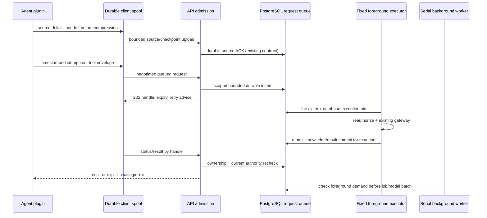

# Queued tools and native lifecycle adapters



AF06801: Tool functions commit/close their own connections. Deferred connection
scope must retain a root transaction and prevent every early physical commit,
including transaction contexts. Final result and effect share one commit.
AF06802: Read result caches can survive scope revocation. Capture exact immutable
credential plus permission fingerprint; current mismatch denies release.
AF06803: Bounded idempotency cleanup risks duplicate late writes. Created-time
admission window plus retained accepted identity prevents timestamp refresh replay.
AF06804: Worker priority alone cannot control Ollama. Gate each shared model call,
use single-input background pages, and pause background job admission under load.
AF06805: Native hosts differ. Codex/Claude pre/post events, Gemini PreCompress's
advisory/asynchronous semantics and agy's fallback must never be conflated.

## As-built correction reconciliation

- Admission uses a short queue reservation separate from canonical-write capacity;
  transient execution pressure retains the accepted envelope with a1second retry.
- Result publication serializes briefly with a1second lock deadline; timeout
  rolls back uncommitted effects and retains the same accepted envelope pending.
- Client persistence precedes discovery. UUID consumption maps to the same local
  record; observation rotates across unread terminal handles. Result GC retains
  an explicit result_expired outcome without implying rollback of knowledge.
- Gemini recording roles cannot prove authorship of synthetic compression input.
  BeforeAgent also carries hook-generated continuations without an origin
  discriminator. Both observations stay separately identified advisory assistant
  context; neither supplies confirmed original user authority.
- Foreground checks cover source claims, embedding pages, curation phases/model
  iterations and opportunistic backup admission. Already running calls stay finite.
- Interrupted package changes retain both known hash generations; explicit recover
  restores only reviewed owned bytes and refuses foreign changes.

- A request deferred on source count/owner/byte pressure yields to the source
  worker that can relieve its dependency. Runnable retrieval and running writes
  still suppress new background work. Retry does not require cancellation/expiry.

## RAG-068-A1 as-built: original evidence across native shortening

Question: which component preserves original authorship before and after a host
shortens context? Requirements FR02/08/09, AC03/04. Verified against
`transcript_origin.py`, `mining_window.py`, `service/local.py`, `source_origin.py`,
`validity.py` and migration033 on2026-11-01. Notation: sequence; arrows represent
actual calls or durable state transitions. Semantic source review only; this
addition has not been rendered.

```mermaid
sequenceDiagram
 participant N as Native host
 participant R as Original-source reader
 participant L as Local durable spool
 participant A as Authenticated source API
 participant W as Serial extraction worker
 participant O as Stopped-stream operator
 participant D as Canonical PostgreSQL
 N->>L: actual pre-compaction original bytes and checkpoint
 N->>R: retained recording, including generated summary
 R->>R: exclude generated IDs; advance compatible cursor
 R->>L: original source window
 L->>A: unchanged envelope until durable ACK
 A->>D: atomic window, cursor, source job and audit
 A-->>L:202 receipt; exact replay returns same receipt
 W->>D: filter old quarantined source IDs before provider
 W->>D: inactive assertion source becomes review, no supersedes edge
 O->>D: DB-backed bounded preview; prove recording coverage
 O->>D: audited quarantine, preserved original rows and quotes
 D->>D:033 ignores only solely generated quarantined replacements
```

Differences from the earlier model: native compaction records are generated
context, even when their transport role says user. Reader exclusion prevents new
misattribution; it cannot repair already attached evidence. The explicit
stopped-stream operator path handles retained local/server work without deleting
originals. Migration033 narrows the temporal exception so ordinary refutation,
removal and expiry still never revive an older value. A free-form reason marker
and its later replacement remain the disclosed LOW-062/LOW-059 limits inIssue75.
Source/claim locking follows the existing attach order; the correction review
accepted its real gateway success/recovery probes at93e455d. Final full-suite and
reference-host acceptance are separate gates.
