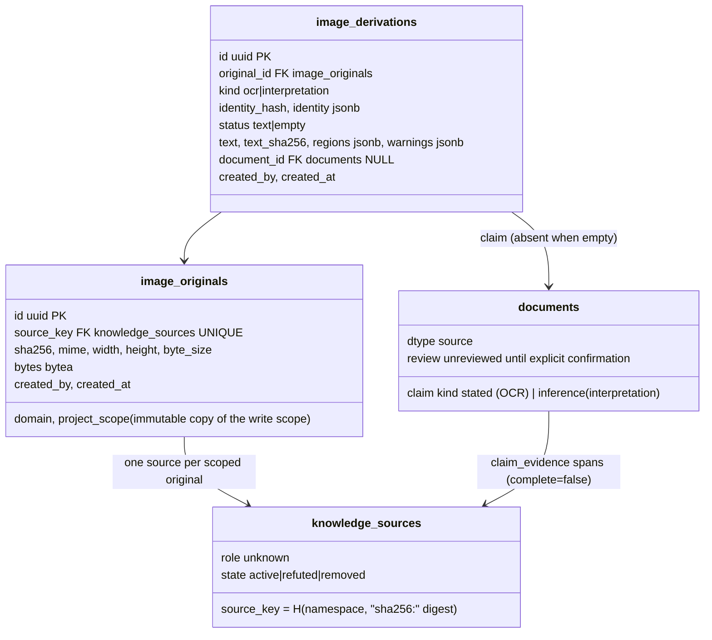
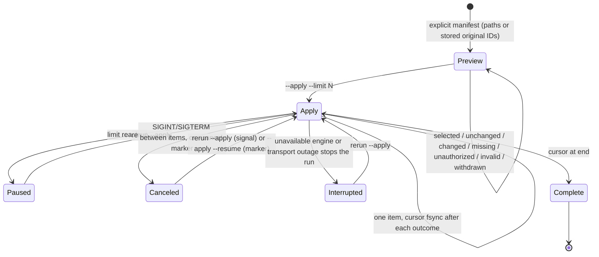

# Source-backed image ingestion (RAG-070)

- Mode: design-time gate (2026-11-03) against store.py, evidence.py, evidence_contract.py,
  SQL012/021/029/035, service/api.py, service/context.py, service/upgrade.py and the
  RAG-070 plan. As-built reconciliation is appended below the diagrams.
- Purpose: AC-001..007, IC-001..005, AF070-001..007. Which component owns authority,
  trust, identity and atomic publication for an image and its derivations?
- Notation: Mermaid. Semantic source review only; no renderer dependency added.

## Data and authority



RLS: `image_originals` uses the SQL035 document-visibility predicate on its own
immutable `domain/project_scope` columns (no reference to another table).
`image_derivations` is visible only through `EXISTS(image_originals)`. Neither policy
references `documents`, `claim_evidence` or `knowledge_sources`, so no policy can
re-enter itself. Both tables are insert-only for `rag_writer`; no UPDATE/DELETE grant.
Source trust and claim review stay in the existing registry and are checked by the
image gateway on every read and publication, in local and central operation.

## Upload, validation and atomic publication

```mermaid
sequenceDiagram
    participant C as CLI file or central upload
    participant G as images gateway
    participant V as Bounded decoder subprocess
    participant E as Tesseract / loopback Ollama subprocess or HTTP
    participant D as PostgreSQL (RLS, audit, evidence)
    C->>G: bytes <= 4 MiB, domain/project, opt-in flags
    G->>G: magic, header dimensions, frames, pixels (no decode)
    G->>D: authorization precheck (domain, write scope)
    G->>V: complete decode, time/memory/output limits
    V-->>G: format, size, frames confirmed or bounded failure
    Note over G: any failure so far: zero writes
    G->>D: Tx A: lock(source_key); refuse withdrawn source; insert source + original; audit; commit (authority recheck)
    G->>D: read derivation for (original, kind, identity) - exists: return, zero engine calls
    G->>E: OCR (and optional interpretation), no transaction or lock held
    E-->>G: bounded TSV / response, identity re-verified
    G->>D: Tx B: lock(source_key); recheck original, source active, duplicate; claim via evidence gateway; derivation row; audit; commit (authority recheck)
    alt engine failure, timeout, revoked writer, audit failure
        G-->>C: explicit code; original retained; no partial derivation
    else concurrent duplicate
        G-->>C: existing derivation, no second claim
    end
```

## Historical processing



The cursor file is an operator convenience only; correctness under loss or concurrent
reruns comes from the idempotent scoped source/derivation keys in PostgreSQL.

## Derived integration cases

Success: real PNG/JPEG/WebP decode + real Tesseract TSV → audited claim → region and
original drilldown → explicit confirmation → retrieval, through local CLI/MCP and the
central REST upload. Recovery: engine timeout followed by successful retry, revoked
writer at commit, audit failure, concurrent duplicates, source withdrawal and
reinstatement, changed identity with preserved review, interrupted backfill resume,
populated 0.6.17/029 and 0.6.23/035 upgrade with independent restores.
