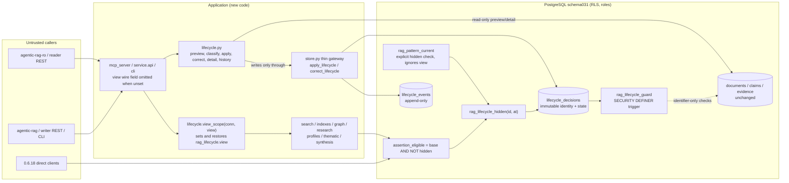
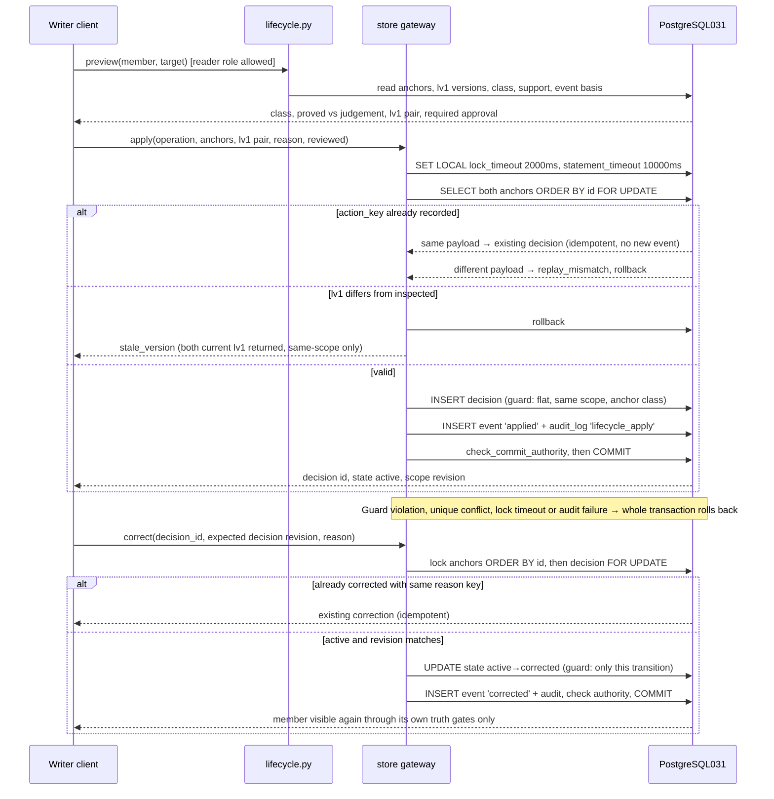
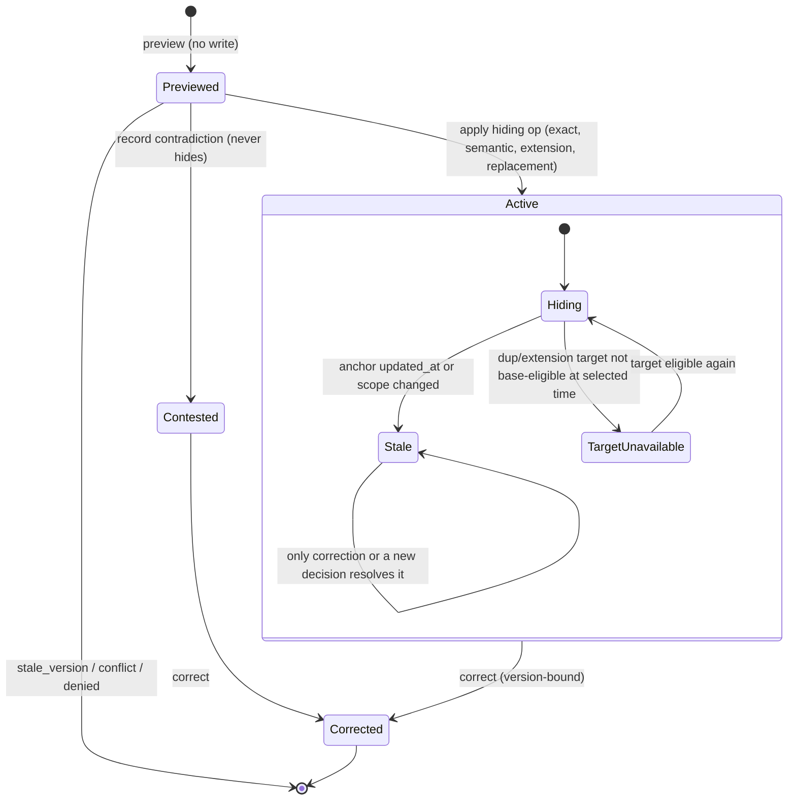

# Source-preserving lifecycle overlay (RAG-066)

- Work: RAG-066 / feature 6.8 / Issue66; mode: **as-built**, correction product `4a7f925`; independent correction and source-bound gates passed.
- Questions: Q1 operation semantics and automatic policy; Q2 where version, flat-chain,
  scope and authority gates run; Q3 how every reader distinguishes current from intentional
  history before `LIMIT`; Q4 how derived outputs invalidate without touching `ev1`;
  Q5 which 0.6.18 readers/writers stay valid before and after first use.
- Requirements: US-001..004, AC-001..010, IC-001..004, FR-001..005; plan
  `../specs/6-8-memory-lifecycle/plan.md`; contract
  `../specs/6-8-memory-lifecycle/contracts/lifecycle-v1.md`; findings AF-066-001..010 in
  `findings.md`.
- Original design evidence (base `d4d2372`, planning head `af7c9d8`): `curation._merge_exact_duplicates`
  and `_lock_scope_pair`; `validity.save` (advisory scope lock, 50-candidate bound,
  event-ordered `supersedes`); migration030 `assertion_eligible`, `claim_eligible`,
  `rag_document_version` (ev1), `rag_pattern_current`, `rag_synthesis_dependency_guard`;
  all `assertion_eligible` callers in sql/013, 015, 016, `indexes.py:218/273`,
  `search._identity_candidates/_expand`, `research.py:295/350`, `profiles._rows`,
  `thematic._state`, `synthesis.py:91`, `mining.py:321`; `profiles.revision/read`;
  `entities.py:312` (`claim_eligible` only); `store._save_txn` (claim/assertion
  immutability, `updated_at` trigger from migration001); `store.get_document`;
  `evidence_contract.inspect:239`; `graph.neighbors/path` omitted-history default;
  `mcp_server.READ_TOOLS/WRITE_TOOLS/ADDITIVE_ARGUMENTS`;
  `service.context.ServiceConnection.check_commit_authority`;
  `service.schema.SCOPED_TABLES` and required-migration subset check;
  `service.upgrade.SUPPORTED_VERSIONS` (`range(18)`) and restore allowlist line 370;
  `tests/service/test_synthesis_upgrade.py` (`SOURCE='81beaf6'`, `old_tree`, `run_old`).
- Notation: Mermaid component, sequence and state diagrams.
- Reconciled on 2026-11-01 against migration031, lifecycle.py, store gateways,
  search/graph/research wrappers, derived-reader decorators and service transports
  at `82c031f`. S1 affected run:1188 passed at351b6f4; coordinator view regressions:
  4 red, then19 passed/exit0. The final independent/full gates are recorded below.
- Diagram notation checked by semantic source review of directives, identifiers, block
  pairing and labels. **No renderer was run; no render is claimed.** No runtime test was run
  for the original design gate; runtime evidence is distinguished above.

## Design decisions in one place

| ID | Decision | Rationale and evidence |
|---|---|---|
| D1 | Overlay, never physical merge. Apply/correct write only new lifecycle rows plus `audit_log`; they never update `documents`, chunks, claims, evidence, edges or pins. | AC-003/006, FR-002. `rag_document_version` (ev1) therefore stays byte-identical for every document, including anchors. |
| D2 | Hiding is enforced once, in SQL: migration031 renames the exact 030 body of `assertion_eligible` to `rag_assertion_eligible_base` and redefines `assertion_eligible(p_id,p_at,p_history)` (same signature, no overload) as `base AND lifecycle-view predicate`; the include-merged bypass applies only to duplicate/extension operations, never replacement. Explicit historical selection adds qualified past-source gates; unset legacy history retains030 behavior. | Every candidate family already filters with `assertion_eligible` before its `LIMIT` (013/015/016, managed indexes, identity, graph, research, profile, thematic, synthesis). One predicate covers them all, for old and new code. An empty lifecycle table returns exactly the 030 result. |
| D3 | Flat canonical invariant: a member of an active hiding decision is never a canonical, and a canonical is never a member. Chain length is exactly 1. | A cycle needs a chain, so cycles are structurally impossible. The visibility predicate never recurses beyond the target's base predicate. A guard trigger plus ordered row locks enforce it. |
| D4 | Anchors are same-domain/same-known-project, active, current-eligible originals: not `dtype='synthesis'`, not in `synthesis_patterns`, `fact_assertions` or `entity_aliases`. | Assertions already own replacement/extension (`validity.save`). Aliases own identity. Excluding them avoids a second truth engine (FR-001) and keeps `entities.py` and 0.6.18 entity readers correct without change. |
| D5 | No new automatic applier. Legacy exact curation (`curation.run_pass`) stays the only automatic exact path and is conservatively tightened to identical title/body/dtype. `exact_duplicate` is a proof class that an operator applies with lower ceremony. | AC-002 and FR-003 permit, not require, an automatic exact policy. Legacy `duplicate_of` plus archive is surfaced as `legacy_duplicate` in detail/history only. |
| D6 | View selection for SQL functions travels in a transaction-local setting `rag_lifecycle.view`, set and explicitly restored by one helper. Unset or empty means `current`. Only `include_merged` widens, and only among rows the caller may already read. | Avoids overloading seven fixed SQL signatures. Mirrors `indexes._bounded`, which restores settings because `SET LOCAL` survives a released savepoint. |
| D7 | A duplicate/extension decision stops hiding when either full content/evidence/state/scope base snapshot changes, or the target is not base-eligible. Its stale status remains visible. Replacement stays suppressive from effective_at until explicit correction even if the target is edited, invalidated or missing; never silently revive the old value. | Edits, scope moves and canonical failure resurface the original (no knowledge loss); a later replacement never revives the superseded value. The no-decision path is an indexed lookup; affected duplicate/extension links require full base-snapshot and target-eligibility checks, which need measured latency. |
| D8 | Old 0.6.18 readers and ordinary writers remain supported with measured limits. Automatic curation workers/hooks must be upgraded/restarted; old-code fallback requires curation_budget=0. | D2 makes old readers honor decisions. Old ordinary writes are tested against the snapshot rules; old curation cannot enforce the tightened exact policy. Old code has no lifecycle tools. Old restore tooling refuses 031 tables through `target_drift`. |

## Q2: component ownership and trust boundaries

Trust notes: `G` uses definer rights for fixed-code validation. `H` also uses
fixed-search-path definer rights, returning only suppression for a caller-visible
member; inaccessible members return false. Decision and event rows remain within
the original scope under RLS even after a member moves. The public detail/get
placeholder reports suppression without original-scope metadata.
`ServiceConnection.check_commit_authority` runs at commit, so a revocation before
commit rolls back decision, event and audit together.

## Q2/Q5: apply, replay, conflict and correction (success and failure)

## Q1/Q3: decision state and member visibility

`Hiding` excludes the member from the `current` view. `include_merged` returns
duplicate/extension members only; explicit historical can include superseded past
records through its trust/time gates, always labelled. `Stale` and `TargetUnavailable` show the member as current
through its own gates and label the relationship in detail/history. A new decision for
the same member requires the old one to be corrected first: a partial unique index allows
one active hiding decision per member.

## Q3: selection matrix (applied in SQL before every LIMIT)

| Requested | Search / research / graph candidate | `memory_get` | Derived (profile, thematic, pattern) |
|---|---|---|---|
| omitted | existing default; non-history paths behave as `current` | original record, unchanged payload | always `current` |
| `current` = `latest` | `base AND NOT hidden` | canonical resolution, ≤1 hop, returns `requested_id`, `canonical_id`, `resolution` | n/a |
| `include_merged` | `base` with only duplicate/extension hiding bypassed; replacements remain hidden | eligible active original plus lifecycle block; replacement excluded | n/a |
| `historical` | qualified accepted past records; label; exclude future/refuted/withdrawn truth | eligible active historical original plus lifecycle block | unchanged history branches |

`historical` with `as_of`, or `current`/`include_merged` with `history=true`, fails with
`invalid_view`. Graph keeps its omitted-history default (`graph.py:45`).

## Q4: invalidation

| Output | Mechanism after 031 | New work |
|---|---|---|
| search/graph/research/identity/managed/contextual | `assertion_eligible` in SQL | none beyond D2 |
| thematic | pool uses `assertion_eligible`; digest of candidates changes → `stale` | none |
| profile | `_rows` revalidates entries; `revision()` reads no eligibility | add scope lifecycle token (count and max of events in scope) to `revision()` |
| pattern (6.7) | `rag_pattern_current` → dependency hidden → withheld; correction restores if ev1 and src1 are unchanged | redefine `rag_pattern_current` with an explicit `rag_lifecycle_hidden` check that ignores `rag_lifecycle.view` |
| entity/alias | anchors exclude assertion/alias documents (D4) | none |
| query cache | vectors only | none |
| ev1/src1 | not changed by overlay | none; regression test asserts byte equality |

## Q5: upgrade and code rollback boundary

| Phase | 0.6.18 readers | 0.6.18 writers | Rollback |
|---|---|---|---|
| 031 applied, no decision | identical results (empty overlay); schema check passes (required ⊆ installed) | unchanged | code back to 0.6.18 is safe; schema stays 031 |
| After the first decision | search/graph/research/thematic/profile entries and patterns honor decisions; no labels or views; profile `status` may read `fresh` until the next refresh | ordinary content/scope edits are tested against operation-specific stale rules; old automatic curation is unsupported unless curation_budget=0 | old code keeps reading safely; corrections need new code; restoring a pre-upgrade backup loses later writes; dropping 031 is unsupported |
| 0.6.18 restore tooling against 031 | refused by `target_drift` | n/a | use 0.6.19 tooling |

## Architecture-derived acceptance flows (run after implementation)

- **ACF-066-S (success):** owned PG55460 copy, two domains and two projects, 0.6.18 data
  written by `old_tree` at `d4d2372`. The new CLI previews an exact pair and a semantic
  pair. A writer REST apply runs, then the reader MCP searches with omitted, `current`,
  `include_merged` and `historical` views through the managed index plus graph depth 1.
  `memory_get` runs with and without a view. A profile read and a thematic read follow,
  and an existing pattern that cites the member is checked. A 0.6.18 `run_old` search
  runs on the same store. Assertions: exact label sets, member absent from current before
  `LIMIT` (k=1 still returns the canonical), ev1/src1 of all documents byte-identical,
  pattern withheld, profile and thematic `stale`, old client consistent, one decision,
  one event, one audit row.
- **ACF-066-R (failure and rollback):** same store. Two concurrent opposing applies (A→B,
  B→A) and a replay with a new transport request ID must yield exactly one active
  decision. An injected audit insert failure and a revocation before commit must leave
  zero decision/event/audit rows. A source edit after preview must return `stale_version`.
  Correcting an earlier decision after a later one changes only its own state. After the
  correction, the member is visible again, while a member that was refuted or expired meanwhile
  stays excluded by its own gates. Then the store is restored from the verified pre-upgrade backup with
  the documented loss of later writes, and an empty upgrade retry follows.

## Coordinator reconciliation before tasks

AF-066-001 exclusions and legacy archive boundary are accepted and explicit in spec.
D2/D6 include-merged now excludes superseded replacements, while explicit historical
has qualified-past trust/time gates separate from omitted legacy history. D5 legacy
automatic exact curation requires title/body/dtype equality. D7 compares immutable
base snapshots including evidence/source revisions; lifecycle action counts belong
only to lv1 concurrency identity. Replacement never reactivates old truth merely
because its target disappears; correction still obeys the member's own truth gates.
The diagrams illustrate duplicate/extension availability transitions; replacement
has no automatic Stale/TargetUnavailable-to-visible transition. Assertions/aliases
keep their existing gateways and must remain explained by detail. AF-066-009/010
capture the curation/snapshot obligations. These dispositions supersede conflicting
phrasing in the original design-time report; final runtime proof is recorded below.

Worker compatibility refinement: the automatic exact policy is Python code. An old
0.6.18 worker cannot enforce the title/type guard merely by running against031.
PB-066-OPS must inventory/update/restart worker launchers before normal operation;
old-code fallback must disable curation with `curation_budget=0` and prove that path.
No new schema feature can be claimed to protect an unmodified old curation loop.

## As-built reconciliation and acceptance

Product `82c031f` implements D1–D8 through additive031, the flat decision/event
guards, invoker ls1 snapshots, optimistic lv1, store entry points delegating to
lifecycle transaction code, the SQL before-LIMIT predicate, explicit transport
views and derived current-only scopes. The profile token is appended only once
a scope has events, preserving old cached revisions across an empty upgrade.
The old0.6.18 code and fallback budget0 are exercised by the populated upgrade
harness; no live rollout, real-model or multiple-host behavior is inferred.

The first independent review at `1fc0628` found moved-member metadata leakage
(F1 Medium), repeated history pages (F2 Medium), silent as-member overflow
(F3 Low), cross-scope request-key collisions (F4 Low), and a playbook integrity
check that treated contested relationships as hiding chains (PB-I1 Important).
Correction: original-scope-only RLS plus the Boolean-only definer `H`; history
cursor selects events; `as_member_more` reports the bounded detail list;
request-key uniqueness is per domain/project; integrity counts only active
hiding chains. The independent correction review at `4a7f925` accepted them: 50 assertions,
48passed, two disclosed Low findings, zero probe errors; no C/H/M/Important.
The actual managed-index k=1 success probe passed for the exact pool through
4096 candidates; the larger ANN branch was not exercised. Direct trusted SQL
writers can still create unaudited decisions (F5 Low); the integrity check
flags them and the playbook requires maintainer-led repair.

The coordinator found and fixed explicit-get selection and nested autocommit
current-scope defects before review (four failing cases, then19 tests passed).
Contract differences now state the five additional error codes, version-before-
proof ordering, event anchor columns, ls1-based lv1 and actual transaction owner.
The historical design report is retained; this reconciliation supersedes its
implementation claims. AC/IC/AF coverage remains in tasks.md. T066-011 acceptance is recorded;
T066-012 full suite passed2063/1skip/1knownwarning, exit0,371sourcehashes
unchanged. The populated current031 upgrade/retry/restore and public PB rehearsal
passed in that suite. Quiet post-correction measurements replace prior timings;
Low045..049 remain in Issue75. No deployment is inferred.
