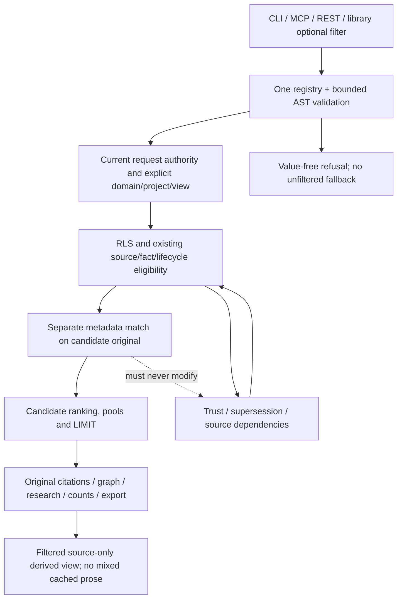

# Typed metadata filter boundary

Purpose: prove optional selection cannot change mandatory truth, privileges or
candidate completeness. Notation: Mermaid flowchart; sources `search.py:search`,
`sql/034_lexical_eligibility_work.sql`, `sql/031_memory_lifecycle.sql:assertion_eligible`,
`sql/033_trusted_replacements.sql`, `indexes.py:_neighbors`, `graph.py`,
`context.py:build`, `profiles.py:_rows`, `research.py:research_async`,
`benchmark/corrections.py:export_confirmed_corrections`. Verified2026-11-04 on
`a151ee5` for design; reconciled with implementation `837517b`, compatibility correction `bcba20d`
and root rehearsal `frozen-bcba20d-final` on 2026-11-04. No production performance claim.
Requirements AC-001..008/IC073-001..005.

## Question: Where can optional selection safely occur?



`assertion_eligible` may examine a newer document that does not match the optional
filter. That document still supersedes the older assertion. Adding filtering to
this truth helper or to a global RLS policy would therefore be incorrect. Apply
an additional predicate only at the result candidate boundary. Source provenance
needed to establish truth is not itself required to share an application label.

Every search branch and shortcut requires the predicate before its own pool/
LIMIT. Managed vectors, contextual hashes and temporal/lifecycle gates remain.
A post-filter of150 raw candidates loses selective matches. ANN must continue
past excluded nearer chunks and fall back explicitly when incomplete. Graph
traversal filters both endpoints and bridge nodes before recursion limits.

## Question: How do derived text, child processes and old code remain safe?

```mermaid
sequenceDiagram
    participant C as Client
    participant S as Existing server / standalone reader
    participant Q as Filtered candidate SQL
    participant R as Research reader child
    C->>S: optional filter + existing selectors
    S->>S: validate030 capability, registry, AST, shorter deadline
    S->>Q: explicit normalized filter parameter
    Q-->>S: matching eligible originals before limits
    S->>R: bounded filter/options + existing current scope
    R->>Q: same original selection at each hop
    Q-->>R: matching original citations
    R-->>S: bounded source-only result
    S-->>C: result or explicit refusal; restore caller state
    Note over C,S: Omitted filter uses unchanged029 reader functions
```

Metadata is advisory `meta.application` through save_document. It never alters
scope columns or review/source states. A registry is operator configuration;
authorized clients inspect its schema but cannot replace it. Unsupported old
servers reject typed options. Upgrades add039 and retain all old function
signatures; rollback removes030-only requests/config without rewriting rows.

## Required analysis and derived integration cases

| Check | Design decision / evidence | Task-worthy proof |
|---|---|---|
| Ownership |store.save_document remains sole canonical writer |metadata/audit failure leaves all rows unchanged |
| Interface mismatch |explicit same AST through tools/child/SQL |CLI/MCP/REST/SDK parity and old-server refusal |
| Dependency cycle |optional match is outside truth dependency graph |newer nonmatching replacement still hides older matching fact |
| Reachable states |missing/null/mismatched typed values explicit booleans |SQL/Python truth table, NOT, malformed historical data |
| Failure / rollback |bounded scoped reads, old funcs retained |timeout/savepoint/autocommit restoration and next unfiltered request |
| Ordering / race |no result/permission cache |revocation on reused prepared connection, concurrent clients |
| Trust |no policy/definer/leakproof changes |foreign scopes and hidden graph bridges never emitted |
| Migration |039 additive, old029 signatures remain |populated restricted-owner upgrade/retry/both restores/old code |

ACF073-S: Under readerA, matching document far behind excluded ANN neighbors is
returned with exact original span; graph/context/research/summary/count/export
select only matching authorized originals. A newer nonmatching replacement
continues to suppress an older matching claim. Separately compare the explicit
source-selection oracle to every surface, not to another wrapper of the matcher.

ACF073-R: Invalid/over-budget filter, source withdrawal, permission revocation and
injected audit error all fail closed; restore complete original bindings and the
next unfiltered request equals029. Upgrade a populated029 copy, interrupt/retry,
independently restore both backups, run old029 code, and preserve originals,
ACLs/owners/sequences/pins/jobs. No production data is used for destructive probes.


## As-built reconciliation

Runtime `metadata.py` implements the shared typed parser, registry, schema,
strict raw JSON boundary and explicit per-operation SQL/deadline scope.
`metadata_stdio.py` guards duplicate typed JSON before SDK decoding without a
global SDK mutation. `store.save_document` locks and merges the registered
application envelope within its existing audited transaction. No authority,
truth helper, RLS policy or published migration001–038 changes.

SQL039 adds nine filtered retrieval/vector/graph siblings and pure invoker
matchers. A complete machine comparison against the latest committed function
bodies in migration order yields identical bodies after removing only optional
metadata predicates/new sibling names and spelling out original default bounds.
Python gates cover identity shortcuts, managed-generation hydration, graph
promotion, entity/research hops, counts and complete-family export.

Filtered context/summary uses matching originals instead of modifying the
existing profile/checkpoint/pin machinery. Thus `profiles.py` and hook callers
need no runtime rewrite. The new reader tool and wire arguments preserve
unfiltered defaults. Both actual HTTP surfaces and the real research child
passed their recorded checks.

| Derived case | Observed result | Limits |
|---|---|---|
| ACF073-S | Fixed original-ID oracle13cases,76assertions; CLI/REST/MCP; literal spans; raw ANN270excluded+300permitted; graph/summary/context/count/export and replacement tests pass. | Contextual ANN continuation beyond256 indexed contextual rows is a documented Low coverage gap. |
| ACF073-R | Generic prepared same-session revocation/restoration; explicit invalid and timeout errors; audit rollback; archived029 interruption/retry/limited-owner source+target independent restores and old clients pass. | Synthetic local PG17; production and macOS require their separate delivery verification. |

The root did not implement the runtime slice and independently reviewed its
complete60-file bounded diff: C0/H0/M0, one Low test-coverage finding.
The operator procedure is [PB07301](../metadata-filters.md); practical sample
sizes, overhead and the observed bounded scan are in the
[verification record](../verification/typed-metadata-filters.md).

Unfiltered direct Python readers omit every039 matcher expression entirely,
rather than relying on SQL short-circuit evaluation. This preserves parsing on
archived035/038 stores. Explicit typed requests still require039 and retain the
same predicate location before candidate limits. No matcher or truth gate is
installed into the old schema to make a no-filter call work.
