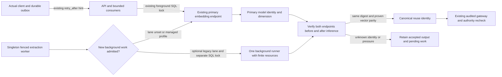

# Issue92 A2: optional background embedding isolation

Purpose: identify the admission and identity boundaries changed by A2 before
implementation. Source: runtime5667ee7, independent design review6ffeb3d,
`docs/specs/6-10-agent-plugins/plan.md` A2. Requirements FR04..08, AC02/04/05.
Date2026-11-01. Mode: design; conditional on E-LANE-1. Mermaid source inspected
semantically; not rendered. The absence of a renderer is not a runtime result.

No step truncates or replaces an original, weakens a truth/access gate or
publishes a result before its existing authorization check. Existing shared
model admission remains the default; the optional background runner is not a
new knowledge store. Physical resource feasibility, lane failure recovery and
actual-client observation are unexecuted gates, not claims of this diagram.
