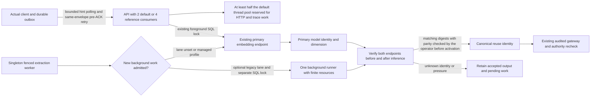

# Issue92 A2: optional background embedding isolation

Purpose: reconcile the admission and identity boundaries changed by A2 with
the implemented runtime. Sources: runtime919cf0b plus client correction41583cb,
independent S06808 correction review at4828f1a and post-B3 review at2d8b79c,
`docs/specs/6-10-agent-plugins/plan.md` A2. Requirements FR04..08, AC02/04/05.
Date2026-11-01. Mode: as-built reconciliation after S06808 implementation.
Independent simulated-model integration and client correction are accepted;
physical L2/L3 recovery and actual-client load acceptance remain pending. Mermaid source inspected
semantically; not rendered. The absence of a renderer is not a runtime result.

No step truncates or replaces an original, weakens a truth/access gate or
publishes a result before its existing authorization check. Existing shared
model admission remains the default; the optional background runner is not a
new knowledge store. Physical resource feasibility, lane failure recovery and
actual-client load observation are unexecuted gates, not claims of this diagram.

B3 physically exercised4 consumers, primary threads2 and background threads1
with complete synthetic inputs, unchanged limits and full original drain. Its
numerical result meets the revised target, while source-bound final input parity
and actual-client measurement are still owed. Typed configuration and runtime
failure recovery now have real-component tests with simulated model HTTP;
those tests do not establish physical-model parity. Preserve B3's original10s
failed gate and protocols.

The consumer reserve is a startup bound, not a measured performance improvement:
1..4 configured consumers must fit within half the computed default CPython
pool. Keep `asyncio.to_thread`, ContextVar propagation and wait-for-live-gateway
shutdown. No own executor is required. The API's namespace12/s limit and four
control slots stay unchanged. All deployed queued servers already advertise
hint1, so new clients also poll old queued servers at approximately1Hz; the
fallback for missing hints is defensive only.

Before ACK, transient contention/timeouts retry the same persisted envelope with
0.3s plus bounded jitter until the caller deadline. After ACK, clamp finite
numeric hints to the configured poll floor and8s cap, plus bounded jitter.
Permanent failures, negotiation failures and legacy synchronous requests are
not automatically retried. Expiring the deadline returns the retained handle
with `waiting`, which fails acceptance.

ACF092-A2-S: actual RemoteClient -> unchanged authenticated request queue ->
four bounded consumers -> primary embedding -> authorized publication -> client
terminal observation, alongside singleton-worker background lane -> identity
guards -> audited gateway, with complete13-original drain and no fallback.
ACF092-A2-R: stop the optional daemon or swap its digest during a page; the real
worker must retain its attempt and accepted output, publish no wrong vectors,
then recover without a second extraction call. Removing optional settings and
restarting restores the default single lane/two consumers without deleting work.
Prove these through real client/queue/worker/SQL components, not diagram assertions.

## As-built evidence and differences

At919cf0b (unchanged by41583cb), `config.py` validates the optional lane settings and consumer count;
`requests.check_consumers` enforces the pool reserve before starting consumers.
`embed.embed_texts` selects the lane only for a fenced central background call,
`priority.model_slot` chooses its distinct advisory lock, and `_lane_embed`
checks both endpoints before and after inference. The gateway, worker authority,
primary reuse identity and managed-profile route are unchanged.

`client.RemoteClient` retains the durable envelope across pre-ACK retries and
uses bounded server hints after ACK. Since41583cb, each valid hint also resets
the fallback delay to the configured polling floor; interleaved429 responses
therefore do not retain an earlier exponential delay. Oversized integers, non-finite numbers and
non-numeric hints take the exponential fallback. Two small refinements preserve
the retained handle: a permanent post-ACK4xx returns immediately, and the final
10ms of the deadline do not cause an additional near-zero wait and poll.

The coordinator's source-bound seven-file selection at919cf0b passed151 tests
(exit0,71.73s), including the populated0.6.21 upgrade, interrupted retry,
independent source/target restores, actual-client queue round trips, lane outage,
digest changes, accepted-output replay and default-setting recovery. Model HTTP
was simulated. Independent ACF092-A2-S/R acceptance with simulated model HTTP
and the client reset correction were accepted at20e2bd4 and4828f1a. Physical
L0/L1 passed the three-input rehearsal on590400a. Physical L2/L3 recovery,
full-input physical parity, the final40-client run and the full suite remain
separate open gates.
