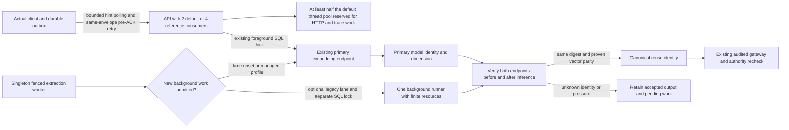

# Issue92 A2: optional background embedding isolation

Purpose: identify the admission and identity boundaries changed by A2 before
implementation. Source: runtime0a08785, independent post-B3 review at2d8b79c,
`docs/specs/6-10-agent-plugins/plan.md` A2. Requirements FR04..08, AC02/04/05.
Date2026-11-01. Mode: implementation design after B3's numerical strict<11s pass.
Product implementation and actual-client acceptance remain pending. Mermaid source inspected
semantically; not rendered. The absence of a renderer is not a runtime result.

No step truncates or replaces an original, weakens a truth/access gate or
publishes a result before its existing authorization check. Existing shared
model admission remains the default; the optional background runner is not a
new knowledge store. Physical resource feasibility, lane failure recovery and
actual-client observation are unexecuted gates, not claims of this diagram.

B3 physically exercised4 consumers, primary threads2 and background threads1
with complete synthetic inputs, unchanged limits and full original drain. Its
numerical result meets the revised target, while source-bound final input parity,
typed configuration, runtime failure recovery and actual-client measurement are
still owed. Preserve B3's original10s failed gate and protocols.

The consumer reserve is a startup bound, not a measured performance improvement:
1..4 configured consumers must fit within half the computed default CPython
pool. Keep `asyncio.to_thread`, ContextVar propagation and wait-for-live-gateway
shutdown. No own executor is required. The API's namespace12/s limit and four
control slots stay unchanged. All deployed queued servers already advertise
hint1, so new clients also poll old queued servers at approximately1Hz; the
fallback for missing hints is defensive only.

Before ACK, transient contention/timeouts retry the same persisted envelope with
0.3s plus bounded jitter until the caller deadline. After ACK, clamp finite
numeric hints to the configured poll floor and8s cap, plus bounded jitter.
Permanent failures, negotiation failures and legacy synchronous requests are
not automatically retried. Expiring the deadline returns the retained handle
with `waiting`, which fails acceptance.

ACF092-A2-S: actual RemoteClient -> unchanged authenticated request queue ->
four bounded consumers -> primary embedding -> authorized publication -> client
terminal observation, alongside singleton-worker background lane -> identity
guards -> audited gateway, with complete13-original drain and no fallback.
ACF092-A2-R: stop the optional daemon or swap its digest during a page; the real
worker must retain its attempt and accepted output, publish no wrong vectors,
then recover without a second extraction call. Removing optional settings and
restarting restores the default single lane/two consumers without deleting work.
Prove these through real client/queue/worker/SQL components, not diagram assertions.
