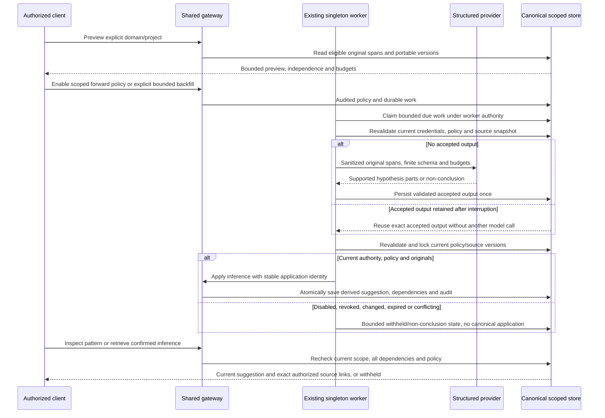

# Scoped synthesis acceptance and publication

- Work: RAG-065 /6.7 / Issue65; mode: design-time.
- Question: where must authority, evidence and policy be checked so a retried background inference never becomes stale or unauthorized truth?
- Requirements: AC-001..009; IC-001..004; plan `../specs/6-7-pattern-synthesis/plan.md`.
- Evidence: existing `evidence_contract`, `store.save_claim`, `service.context.ServiceConnection`, `service.worker`, `worker`, `jobs` and migration029. Proposed new nodes are explicitly prospective.
- Owner: coordinator; verification2026-10-31: semantic Mermaid-source review, no renderer claim.

No edge connects generated patterns back to the candidate pool. Provider output has no authority to choose a scope, introduce a source, mark a user statement or confirm evidence. The gateway owns application; the existing worker owns execution and durable retry. Policy disable and source drift fail closed at reads as well as writes. Keeping a rejected/disabled suggestion for audit does not authorize exposing its stale body.

As-built reconciliation and architecture-derived success/recovery tests remain pending S2.
