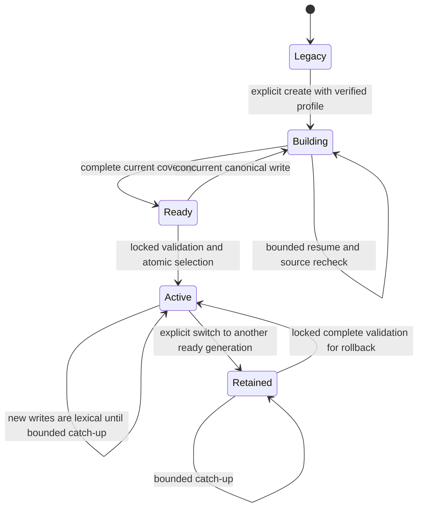
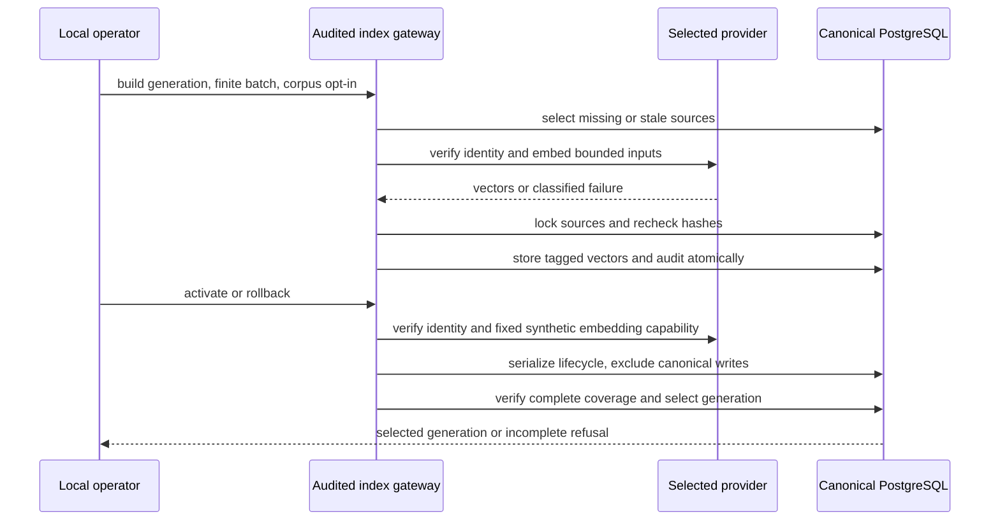

# Provider index generation consistency

Work: RAG-061. Mode: as-built reconciliation. Verified: 2026-10-30.
Question: which transitions preserve a searchable old index and current-source
coverage under concurrent canonical writes? Sources: spec AC003–008, plan IC002–004,
SQL016/021, contextual.py source-hash validation. Validation: semantic Mermaid
source inspection; no renderer claim.

Generation readiness is observed coverage, not a permanently trusted flag. All
generations retain their descriptor. A failed provider request writes no vectors;
the old active pointer is unchanged. Query vectors and stored vectors must use
the same descriptor; no active profile match means lexical search with warning.

Trust boundaries: profile secrets stay in protected references; provider response
bodies are not diagnostics. Global lifecycle work is local-owner-only. Scoped
search uses invoker RLS and eligibility filters before ranking/limits; a definer
write gateway rechecks both source and write authority.

As built: `indexes.create/build/status/activate/rollback` implements these
transitions through audited `store` facades and SQL027. Lifecycle functions are
owner-only; activation/rollback lock both documents and chunks in SHARE mode,
so old binaries participate in the write exclusion. Each generation gets a
dimensions-specific partial HNSW index. The raw-v1 source hash covers chunk
content, title and project scope; replacing chunks cascades sidecar rows.
This avoids hashing a full body for every raw chunk. Contextual lexical scores
retain their separate full-source hash, rechecked at final projection.

Search pins `Selection` before inference and carries it in `BoundQuery`; it can
finish against a retained generation after a concurrent switch. Managed reads
never call legacy inference/query cache or merge raw/context vectors. Optional
contextual lexical recall remains available with NULL query vectors. Missing
profiles/models and semantic SQL budgets select lexical degradation with warning.
Server inference uses the shared foreground model slot; builds yield to
foreground demand and cap background network operations at10seconds.
Research retrieval reuses that selected search space even with structured
assessment disabled; lexical research without assessment makes no model calls.
Selecting an external generation also routes semantic duplicate candidate
title/body there. These opt-in effects are explicit in the provider procedure.

No topology drift. The legacy state explicitly retains unverified historical
semantics until managed activation; its old vectors receive no retroactive
identity certificate. Guarantees about verified vector spaces apply to managed
generations and new-binary reads. Code rollback keeps canonical post-cutover
writes but returns to the old binary's legacy retrieval behavior.

Evidence: provider109+offlinecache14 tests; index82+3 tests; coordinator integrated
search/CLI/index44 tests; populated upgrade/restore/schema26 tests, all observed
exit0. Final independent integration/review/full-suite evidence is recorded in
the linked verification record; these bounded results do not establish production
or real-model readiness. AF061-005 is implemented: the real source HTTP→worker→
receipt/trace chain retains bounded classified errors (24 related tests passed,
31.35s, exit0). AF061-007 selection additionally proves capability/dimensions
with a fixed synthetic input before canonical locks, including an empty corpus
(94 provider/index/search/CLI tests passed,61.92s, exit0). The derived CLI recovery
test passed independently (5.65s, exit0); same/different-dimensional ranking and
in-flight selection pinning passed6 tests (4.39s, exit0).
