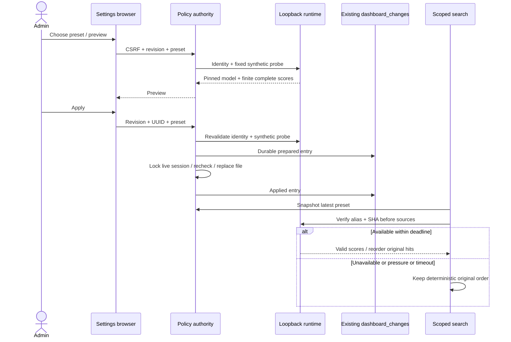

# Reranker settings authority and runtime boundary

Question: how can a browser change search ordering without modifying knowledge,
losing audit history, racing session revocation or mixing model identities?
Source: RAG-062 settings spec AC002–007; plan; existing dashboard_policy._store,
neural_rerank.order and service/engine.py. Notation: Mermaid sequence.
Mode: as-built,2026-10-31. Migration028 extends only the audit-kind CHECK.
Config rejects reserved aliases with inconsistent SHA; a shielded executor owns
native slot release, including cancellation before worker start. The bundled
daemon binds127.0.0.1 only; the legacy adapter can still use external IPv6 loopback
runtimes. Unsupported native binds fail before model loading.

Recovery: process exit after replace leaves prepared journal; existing policy
recovery compares old/new file revisions and marks applied or not-applied. Unknown
drift fails closed. The next policy apply reconciles a prepared entry; GET does
not mutate the journal. Old0.6.14 ignores [reranker] and accepts schema028; keep
the additive constraint and audit history during code rollback.

Integration gates: IT062-SUCCESS in tests/service/test_reranker_settings.py
exercises in-flight snapshot, subsequent REST/MCP, restart and foreign-scope
exclusion. IT062-RECOVERY in tests/service/test_reranker_upgrade.py exercises
verified027-to028 restore, interrupted settings commit, process recreation,
prepared journal reconciliation, wrong-SHA fallback and real0.6.14 reads.
Cancellation and reserved-identity regressions are in tests/test_reranker_settings.py.
