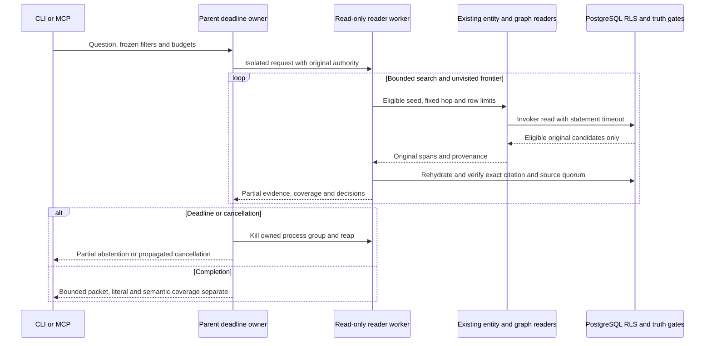

# Bounded research exploration trust boundary

- Mode: design; verified2026-11-02 against c33e11f and RAG-069 plan.
- Purpose: AC002–005, IC002/003. Which component prevents hidden intermediate
  identities or graph candidates from becoming evidence, and who stops blocked work?
- Notation: Mermaid sequence. Semantic source review; no renderer dependency added.

No persistent state crosses this operation. The worker owns the request-local
visited set; parent isolation remains the hard bound on all nested dependencies.
Alias metadata is published only with retained eligible evidence; ambiguous aliases
never seed traversal. Graph endpoints are checked before row limiting and again
before original excerpts enter the packet. Derived integration cases: a two-hop
read under real RLS, and identity/graph failure followed by an independent successful
read with unchanged canonical rows. The independent final reviewer derives additional
success/recovery cases after as-built reconciliation.
