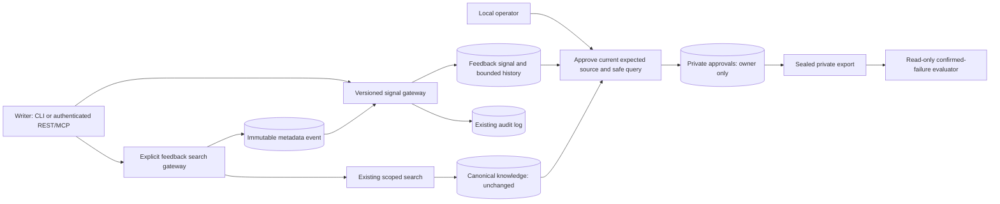

# Retrieval feedback ownership (RAG-071)

- Mode: design-time,2026-11-03, source9ee02b7, Python/service/SQL001..036 inspected.
- Purpose: AC-001..009 and IC-001..005; questions below answer authority, privacy
  and atomicity before implementation. Mermaid source semantic review; no renderer
  dependency added.

## Q1: Can feedback reuse retrieval without acquiring truth authority?



There is no edge from feedback back to source trust, claim review or ranking.
Ordinary search does not capture an event. New writer tools preserve the read-only
server contract. Metadata snapshots contain IDs/versions/digests, never bodies or
raw queries. Local operator approval is the only path retaining a reconstructed
query, screened and kept in an owner-only table/private export.

## Q2: What makes retries, revocation and updates safe?

```mermaid
sequenceDiagram
  participant C as Authenticated client
  participant G as Scoped feedback gateway
  participant D as PostgreSQL
  C->>G: event/key or signal/expected revision
  G->>D: namespace lock; visibility, rate and quota checks
  alt matching idempotent replay
    D-->>C: existing event/signal
  else new or current revision
    G->>D: validate current document/source versions
    G->>D: event or signal/history plus audit
    G->>D: commit with current credential authority
    D-->>C: record/revision
  else stale, foreign, revoked, full or audit failure
    G->>D: rollback
    G-->>C: uniform unavailable, conflict or bounded refusal
  end
```

Signal RLS requires immutable namespace plus existing domain/project rules.
Idempotency keys are actor/client-scoped. Aggregation uses stable user identity,
so a second machine is not a second independent actor. Approvals bind signal
revision and expected-source versions; update/retract/source withdrawal makes
them stale without changing knowledge. Never use a cached permission decision.

## Q3: What survives upgrade and rollback?

Migration037 adds event/signal/approval tables only. Existing knowledge, vectors,
jobs and policies are unchanged. Upgrade invokes no model or capture. Old027
readers continue against036-compatible knowledge; old schema-aware operators may
refuse the newer migration list. Disabling feedback and returning to027 code
retains all feedback rows. Independent dump/restore covers both original and new
tables, and an interrupted migration rolls back fully.

## Derived integration probes

- Success: scoped search -> event -> negative feedback -> explicit safe query and
  current expected-source approval -> private export -> read-only miss/hit report.
  Whole connected source families remain in one split; knowledge hashes equal.
- Recovery: force an audit error, observe no signal/history, retry same key once;
  revoke the writer or change source version before approval/export, observe
  refusal/withheld without leaked metadata, restore authority and retry explicitly.
- Upgrade/recovery: populated archived027 -> interrupted037 -> unchanged source ->
  retry -> feedback writes -> independent source/target restores -> old027 read.

## Findings to implementation

AF071-001..006 in `findings.md` are binding response items. As-built reconciliation
must check tool registration, permission rechecks, private-query ownership,
idempotency/audit transactions, family independence and actual upgrade evidence.
