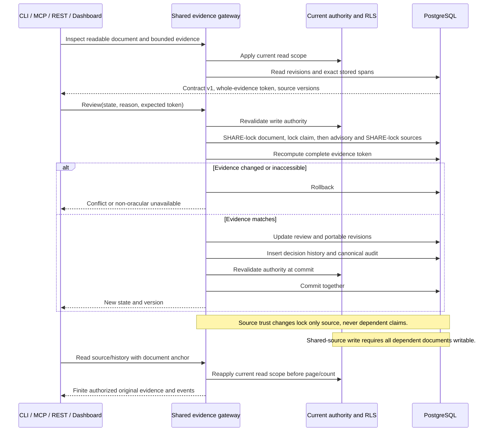

# Source-evidence decision ordering

Question: how can all clients review exactly inspected evidence without a stale source race, authority bypass or partial audit?

- Work: RAG-063 / Issue63; mode: as-built; verified2026-10-31.
- Requirements: AC-003..006, IC-001..004.
- Sources: evidence.py attach/source_state/review, service/context.py commit authority, sql/021_service_scope.sql RLS, service/read_limits.py and the feature plan.
- Notation: Mermaid sequence; semantic source inspection only, no renderer claimed.

Design analysis: attachment already uses claim→source order, so claim reviews must do likewise. Source updates must not acquire claim locks. Source revisions are persisted, survive restore and prevent ABA. History is scoped separately from the global audit table. Existing eligibility checks re-evaluate consumers; as-built reconciliation must test derived paths rather than trusting a version label.

## As-built reconciliation (2026-10-31)

`evidence_contract.inspect/history` are the single presentation producers; MCP
and local CLI use repeatable-read read-only snapshots. REST reuses the MCP
registry; the dashboard queues the same tools and requires versions for writes.
Migration029 uses side tables and trigger revisions, so all original columns
remain untouched. History RLS follows visible parents; there is no global audit
read grant. Legacy get/provenance fields remain available for compatibility;
new source navigation uses opaque references.

The initial advisory-only implementation differed from the design's source row
locks: an actual 0.6.15-style concurrent UPDATE allowed a stale strict review.
Coordinator regression reproduced it (one failure), then row SHARE locks via
`rag_lock_claim_source` fixed it. The helper returns no data, checks writable and
readable anchor plus membership, and bypasses only the overly broad source-wide
UPDATE policy for locking. A direct FOR SHARE was experimentally shown to hide
a shared readable source under that policy. Source mutation retains that policy.
A concurrent document archive likewise now blocks before comparison through a
document SHARE lock. Tests cover both races and authorized review of a source
whose other dependent is unwritable. Source-only writes still acquire no claim lock.

Encoded quotes and legacy reasons share finite presentation budgets. Historical
reasons are truncated explicitly without changing stored originals. The current
SQL eligibility gates continue to control search/context/profile/thematic and
research acceptance; the thematic history label was corrected to match existing
domain-isolated supersession. Populated028 upgrade, interrupted retry, old-code
reads/writes and restored portable versions are executable integration fixtures.

Semantic Mermaid source review: directive, participants, message order and alt/end
pairs inspected; no renderer is installed or claimed. All design differences
have explicit implemented dispositions above. Independent architect-derived
success/recovery tests and complete final review remain delivery gates.
