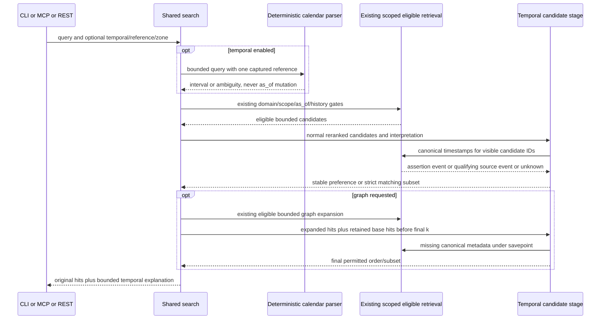

# Temporal query authority boundary

Mode: as-built reconciliation. Work RAG-064 / stable6.6. Question: where can a temporal preference/filter act without replacing explicit validity or enlarging current authority? Requirements AC-002..007 / IC-001..003. Sources: search.py:search/_expand, validity.py:selection, sql/020_domain_assertions.sql, sql/023_claim_lookup.sql, evidence.py, service/engine.py. Verified2026-10-31 against implementation e6cd548 and coordinator correction tests. Mermaid sequence notation; semantic source inspection of participants, messages and paired blocks, no renderer claimed.

Analysis: parser reference and validity selection are independent clocks with different meanings; no cycle or write is introduced. Canonical metadata remains in the existing store. The temporal stage can reorder/exclude already authorized hits only. Unknown dates and future assertion eligibility cannot be repaired through ranking. Off/no-intent must skip metadata work and keep legacy envelopes. Failure path: soft mode safely preserves eligible base order with fixed warning, strict mode fails closed; catch SQL failures using a savepoint or propagate rather than return an aborted transaction. Candidate limits remain explicit.

As-built dispositions:

- `temporal.py:interpret` implements one captured aware reference, bounded EN/DE grammar, calendar ZoneInfo endpoints and explicit ambiguity; search._interpret never mutates validity.selection. Client surfaces use auto; internal library callers retain None/legacy unless explicitly opted in. No new dependency/provider call.
- `search._TEMPORAL_SQL/_event_metadata` batches only candidate IDs and canonical qualifying timestamps under existing role/RLS; assertion time has precedence, unknown remains unknown. Fresh eligibility rejection removes a hit in prefer as well as filter, covered by concurrent gateway source withdrawal before metadata lookup.
- `search._TemporalStage` owns stable preference/filter and the additive envelope; savepoint recovery preserves transaction usability, hard failure returns no result. The final graph guard retains original selected hits until after the temporal k boundary. A reproduced k=3 eviction is corrected; k=3 and5 are tested.
- `config.py`, local/remote CLI and MCP share optional mode/reference/timezone; unset new arguments are omitted on old-service requests. Client-mode CLI now routes search centrally, a documented compatible extension tested through authenticated REST. No changes to schema SQL, audited writes, scopes or provider configuration.
- Source0.6.16/schema029 populated by actual archived code retains non-operational table hashes through new reads, old local/REST reads and disabled-feature rollback. The existing public operator workflow now admits source0.6.16 and its backup/restore/preservation no-migration path is tested. Editable package metadata is refreshed separately from repository versioning.

AF-064-001..003 are addressed at implementation/model boundary. Independent architecture-derived success/recovery and complete review remain required; this reconciliation does not claim those gates or full-suite completion. Semantic Mermaid source inspection checked participants, relationship direction and paired opt blocks; no renderer installed or rendered proof claimed. Playbook assessment unchanged: no schema/persistent write or live deployment operation.
