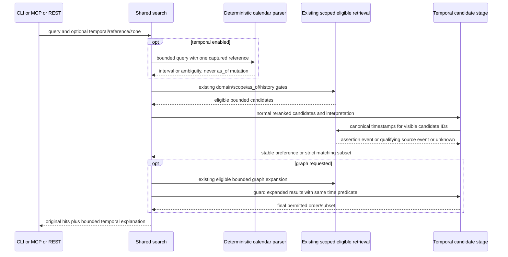

# Temporal query authority boundary

Mode: design-time. Work RAG-064 / stable6.6. Question: where can a temporal preference/filter act without replacing explicit validity or enlarging current authority? Requirements AC-002..007 / IC-001..003. Sources: search.py:search/_expand, validity.py:selection, sql/020_domain_assertions.sql, sql/023_claim_lookup.sql, evidence.py, service/engine.py. Verified2026-10-31 at8772fbd. Mermaid sequence notation; semantic source inspection of participants, messages and paired blocks, no renderer claimed.

Analysis: parser reference and validity selection are independent clocks with different meanings; no cycle or write is introduced. Canonical metadata remains in the existing store. The temporal stage can reorder/exclude already authorized hits only. Unknown dates and future assertion eligibility cannot be repaired through ranking. Off/no-intent must skip metadata work and keep legacy envelopes. Failure path: soft mode safely preserves eligible base order with fixed warning, strict mode fails closed; catch SQL failures using a savepoint or propagate rather than return an aborted transaction. Candidate limits remain explicit.

Findings AF-064-001..003 in findings.md are tasked before implementation. As-built reconciliation and independently derived success/recovery tests remain pending.
